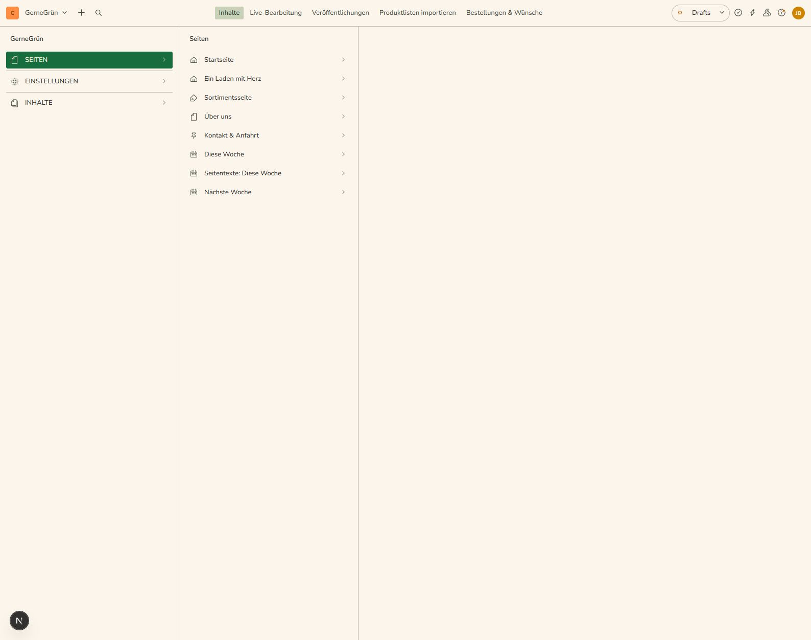
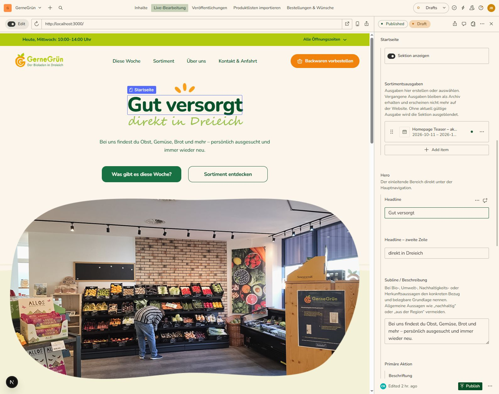
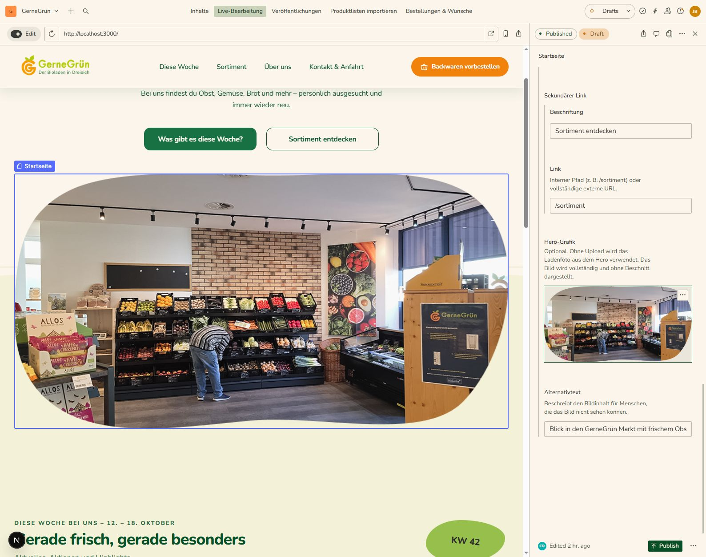
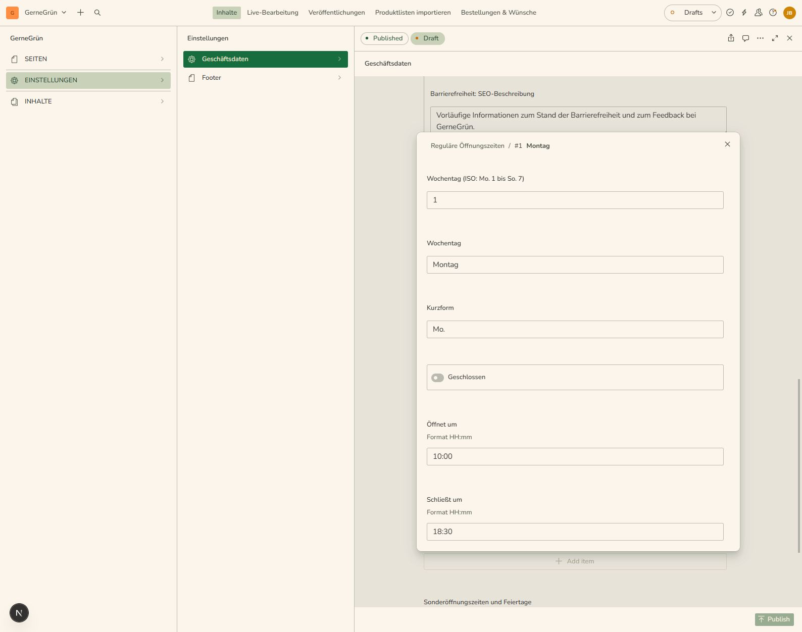
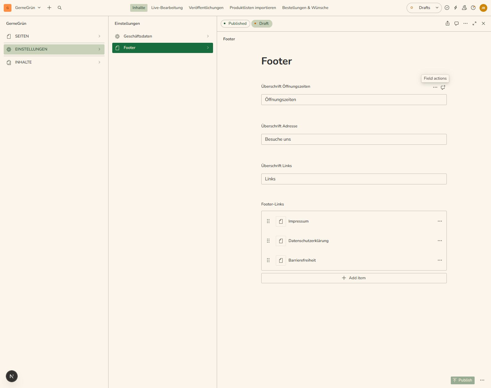
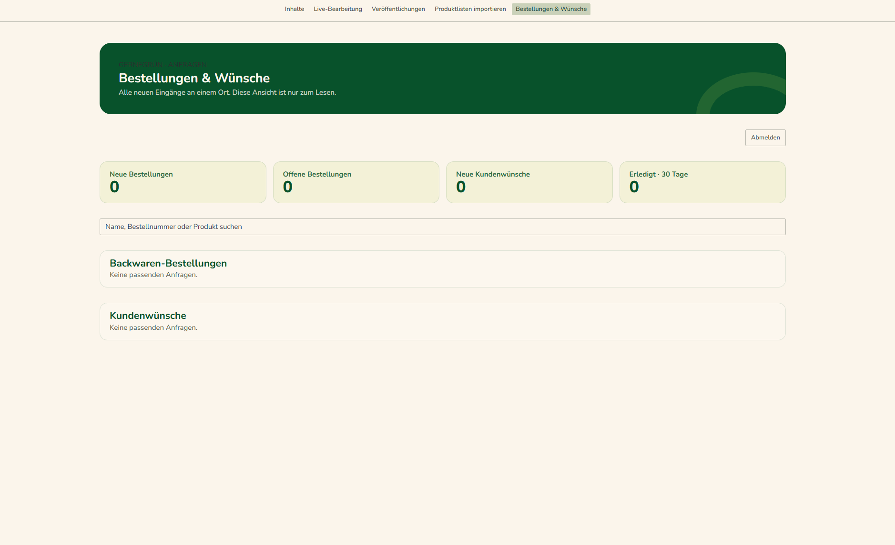

# GerneGrün-Website bearbeiten

Diese Anleitung erklärt, wie du Inhalte der GerneGrün-Website sicher und ohne
technische Vorkenntnisse bearbeitest. Für die meisten Änderungen ist
**Live-Bearbeitung** der einfachste Einstieg: Dort siehst du die Seite und
kannst viele Texte und Bilder direkt anklicken.

Die gestaltete Anleitung gibt es auch als [**PDF zum Herunterladen**](../output/pdf/GerneGruen-Anleitung-Sanity.pdf).

> **Datenschutz:** Beim Bestellungen-Dashboard dürfen keine echten Namen,
> E-Mail-Adressen oder Bestelldetails in geteilten Screenshots zu sehen sein.

## 1. Zugang einrichten und anmelden

### Sanity-Konto

Sanity ist das Redaktionssystem der Website. **Du brauchst ein persönliches
Sanity-Konto.** Eine Einladung zum GerneGrün-Projekt richte ich als Admin für
dich ein.

1. Öffne [**sanity.io**](https://www.sanity.io/) und erstelle dein persönliches
   Sanity-Konto. Du kannst dich mit deiner E-Mail-Adresse oder einem angebotenen
   Anmeldeanbieter wie Google registrieren.
2. **Schicke mir die E-Mail-Adresse deines neuen Sanity-Kontos.** Ich lade dich
   als Admin zum GerneGrün-Projekt ein. Du musst selbst keine Einladung
   versenden oder ein Projekt einrichten.
3. Öffne [**gernegruen.de/studio**](https://gernegruen.de/studio), sobald du die
   Einladung erhalten hast.
4. Melde dich dort mit **demselben Sanity-Konto** an, das du mir genannt hast.

Wenn du nach der Anmeldung noch keinen Zugriff auf GerneGrün siehst, sag mir
Bescheid. **Ich prüfe dann die Einladung und deinen Zugang.**

### Anmeldung für „Bestellungen & Wünsche“

Das Dashboard öffnet sich innerhalb des Studios, hat aber eine zusätzliche
Anmeldung. Verwende dort das freigeschaltete Dashboard-Konto mit seiner
E-Mail-Adresse und seinem Passwort. Das ist nicht automatisch dasselbe wie dein
Sanity-Login. Die Anmeldung bleibt auf diesem Gerät bis zu 14 Tage bestehen.

## 2. Wo finde ich was?

Die Hauptbereiche stehen oben im Studio:

| Bereich | Wofür ist er da? |
| --- | --- |
| **Inhalte** | Seiten und redaktionelle Inhalte im Sanity-Editor öffnen. |
| **Live-Bearbeitung** | Die Website ansehen und unterstützte Texte oder Bilder direkt anklicken. |
| **Veröffentlichungen** | Geplante oder vorbereitete Veröffentlichungen ansehen. Für normale Änderungen meist nicht nötig. |
| **Produktlisten importieren** | Eine neue Obst- und Gemüseliste aus einer Excel-Datei vorbereiten und importieren. |
| **Bestellungen & Wünsche** | Eingegangene Backwaren-Bestellungen und Produktwünsche ansehen. |

Unter **Inhalte → Seiten** liegen Startseite, Diese Woche, Sortiment, Über uns
und Kontakt & Anfahrt. Unter **Einstellungen** findest du die globalen
**Geschäftsdaten** und den **Footer**. Unter **Inhalte** liegen außerdem
Sortimentsausgaben, Kategorien, Marken und Aktionsblätter.

## 3. Seiten bevorzugt in „Live-Bearbeitung“ bearbeiten

1. Klicke oben auf **Live-Bearbeitung**.
2. Wähle in der Vorschau die gewünschte Seite, zum Beispiel Startseite,
   Sortiment oder Kontakt & Anfahrt.
3. Klicke auf einen hervorgehobenen Text oder ein Bild. Rechts öffnet sich das
   passende Sanity-Dokument oder Feld.
4. Bearbeite den Inhalt und kontrolliere die Vorschau.
5. Klicke oben im Dokument auf **Veröffentlichen**, wenn die Änderung auf der
   öffentlichen Website erscheinen soll.

Änderungen werden zunächst als Entwurf gespeichert. Besucher sehen sie erst
nach dem Veröffentlichen. Du kannst also erst prüfen und anschließend
veröffentlichen.

Nicht jedes Element ist einzeln anklickbar. Manche Bereiche stammen aus einem
gemeinsamen oder globalen Datensatz. Wenn ein Klick nichts öffnet, gehe zu
**Inhalte** oder **Einstellungen** und öffne dort den passenden Eintrag.

## 4. Texte ändern

1. Klicke in der Website-Vorschau auf den Text, den du ändern möchtest.
2. Ändere den Text im rechten Bearbeitungsbereich.
3. Prüfe Zeilenumbrüche und die Vorschau. Ändere möglichst nur den Inhalt,
   nicht Formatierungs- oder technische Felder.
4. Veröffentliche das Dokument, wenn der Text richtig aussieht.

Überschriften und Beschreibungen können eigene Felder sein. Wenn du nur einen
Teil eines Textes ändern möchtest, bearbeite nur das dazugehörige Feld.

## 5. Bilder austauschen

1. Klicke das Bild in der Vorschau an. Falls ein Klick stattdessen nur eine
   große Bildansicht öffnet, schließe diese und klicke den Bildbereich erneut
   im **Edit**-Modus.
2. Öffne im rechten Bereich das Bildfeld und wähle **Ersetzen** oder lade ein
   neues Bild hoch.
3. Wähle das neue Bild aus und prüfe den Bildausschnitt in der Vorschau.
   Wenn verfügbar, verschiebe den Fokuspunkt so, dass das Motiv gut sichtbar
   bleibt.
4. Ergänze oder prüfe den Alternativtext. Er beschreibt das Bild kurz für
   Menschen, die es nicht sehen können.
5. Veröffentliche das Dokument.

Verwende möglichst ein passendes, scharfes Foto im Querformat. Logos und
Illustrationen sollten nicht durch beliebige Ersatzbilder ausgetauscht werden.

## 6. Globale Geschäftsdaten und Footer

Öffnungszeiten, Adresse, Telefonnummer, E-Mail und Instagram werden an einer
Stelle gepflegt: **Einstellungen → Geschäftsdaten**. Dieselben Öffnungszeiten
und Kontaktdaten erscheinen im Menü, im Footer und auf der Kontaktseite. Ändere
sie nicht an mehreren Seiten einzeln.

Die Texte und Links der Fußzeile findest du unter **Einstellungen → Footer**.
Dort kannst du die Spaltenüberschriften und Footer-Links bearbeiten. Die
Geschäftsdaten selbst bleiben im Datensatz **Geschäftsdaten**.

## 7. Bestellungen & Wünsche ansehen

1. Klicke oben auf **Bestellungen & Wünsche**.
2. Melde dich mit dem freigeschalteten Dashboard-Konto an, falls du dazu
   aufgefordert wirst.
3. Oben zeigen die Kacheln neue und offene Bestellungen, neue Kundenwünsche
   sowie erledigte Einträge der letzten 30 Tage.
4. Nutze das Suchfeld, um nach Namen, Bestellnummer oder Produkt zu suchen.
5. Klicke bei einem Eintrag auf **Details ansehen**, um die vollständige
   Anfrage zu lesen.

Das Dashboard ist nur zum Lesen eingerichtet. Einträge und Status werden dort
nicht bearbeitet. Kundendaten sind vertraulich und dürfen nicht in öffentlichen
Screenshots oder Nachrichten geteilt werden. Melde dich ab, wenn du ein
gemeinsam genutztes Gerät verwendest.

Der Screenshot zeigt einen **Beispielzustand ohne Kundendaten**. In deinem
Dashboard können Kennzahlen und Einträge anders aussehen. Öffne **Details
ansehen**, um eine Anfrage zu lesen. Das Dashboard ist **nur zum Lesen**: Du
kannst dort keine Einträge oder Status ändern.

## 8. Veröffentlichen und prüfen

Vor dem Veröffentlichen:

- Lies den geänderten Text noch einmal durch.
- Prüfe, ob das richtige Bild und der passende Ausschnitt angezeigt werden.
- Kontrolliere die Seite in der Vorschau.
- Veröffentliche erst, wenn die Änderung bereit ist.

Wenn eine Änderung nicht erscheint, lade die Vorschau neu und prüfe, ob das
Dokument wirklich veröffentlicht wurde. Bei globalen Geschäftsdaten kontrolliere
den zentralen Eintrag **Einstellungen → Geschäftsdaten**.

## PDF-Version

Die PDF bündelt diese Anleitung und alle zugehörigen Screenshots.
